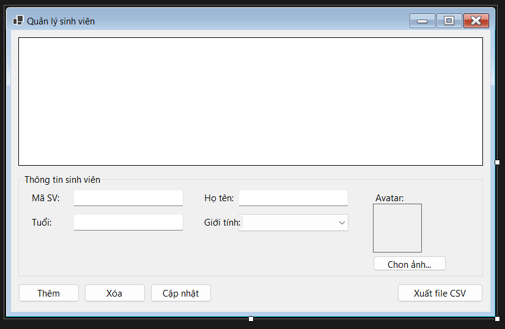
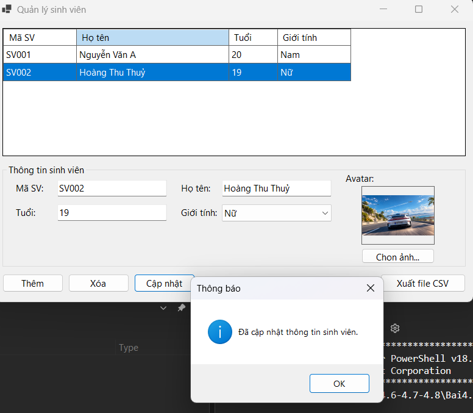
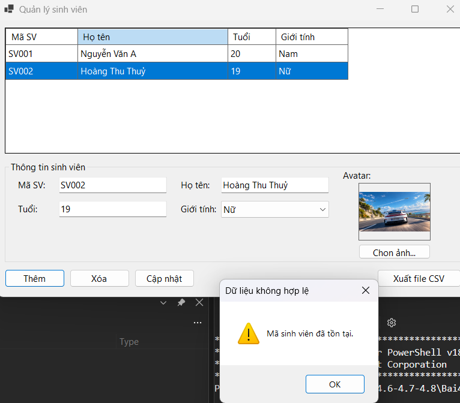
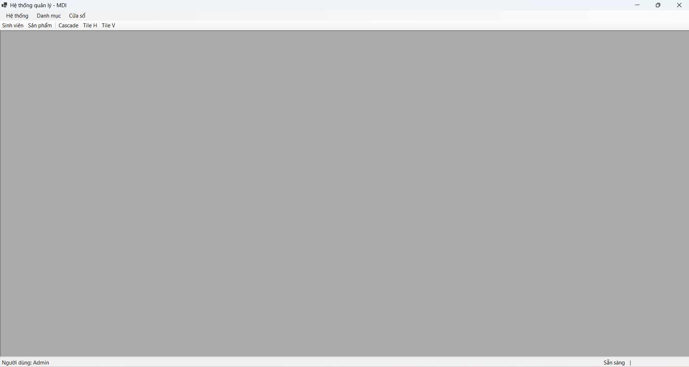
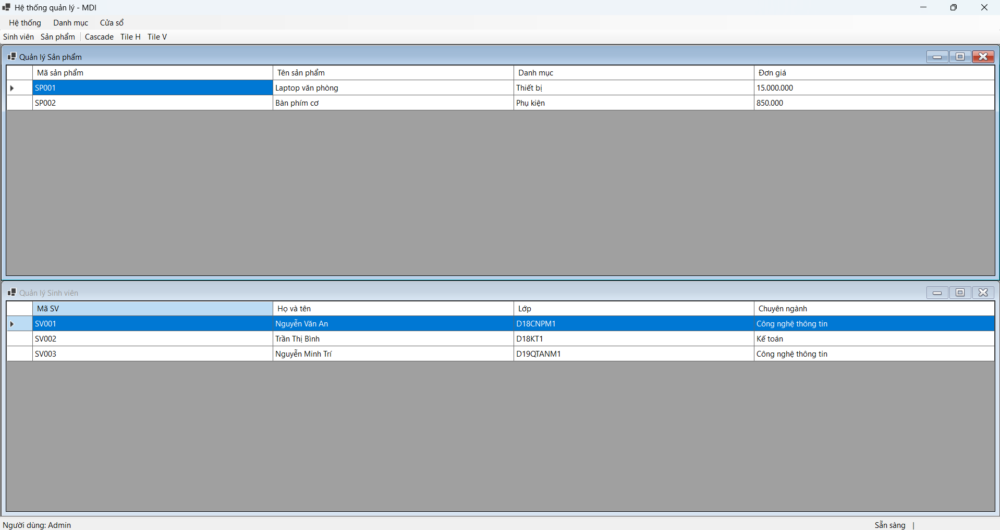
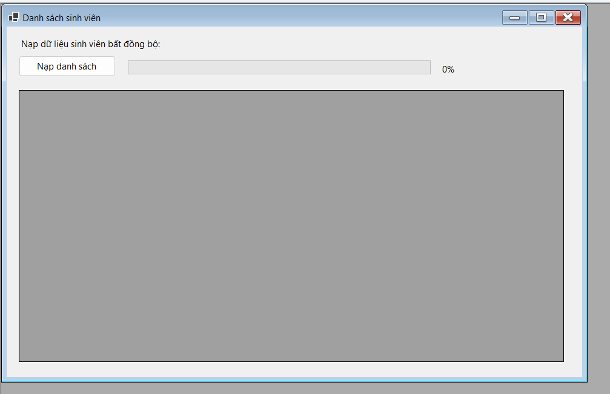
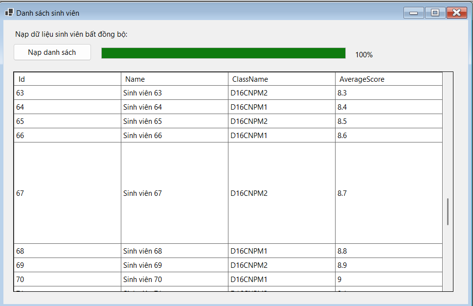

# BÁO CÁO BÀI TẬP NGÀY 12/10/2026

## THÔNG TIN SINH VIÊN
- **Họ và tên:** Nguyễn Minh Trí
- **Mã số sinh viên:** 24810320227
- **Lớp:** D19QTANM1
- **Tên môn học:** Lập trình.net
- **Tên bài tập:** Bài thực hành 4.6 đến bài 4.8

----------------------------

## KẾT QUẢ THỰC HÀNH
## BAI TAP 4.6
### 1. Ảnh màn hình Giao diện chính

### 2. Ảnh màn hình kết quả

---------
.png)
---------
.png)
---------
.png)
### 3. Ảnh màn hình Kiểm tra lỗi (Validation)

---------
.png)

----------------------------

----------------------------

## KẾT QUẢ THỰC HÀNH
## BAI TAP 4.7
### 1. Ảnh màn hình Giao diện chính

---------
.png)
### 2. Ảnh màn hình kết quả

---------
.png)
---------
.png)
---------
.png)
---------
.png)
---------
.png)
---------
.png)

----------------------------

## KẾT QUẢ THỰC HÀNH
## BAI TAP 4.8
### 1. Ảnh màn hình Giao diện chính

### 2. Ảnh màn hình kết quả
.png)
---------

----------------------------