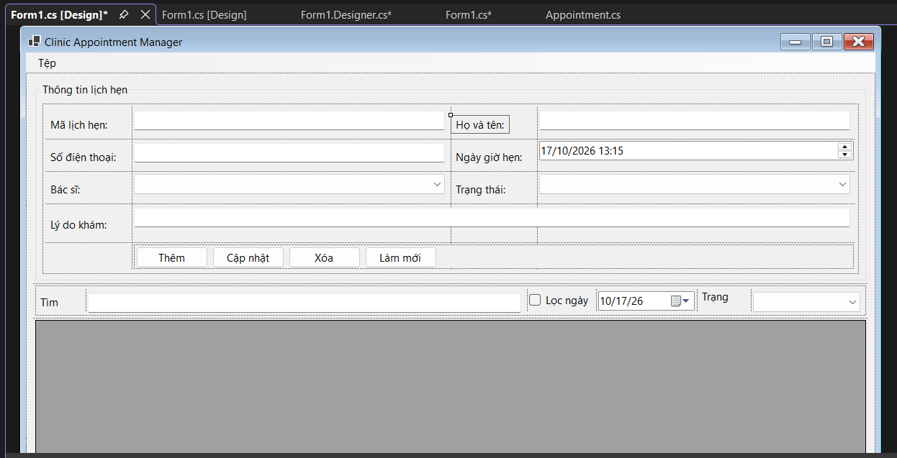
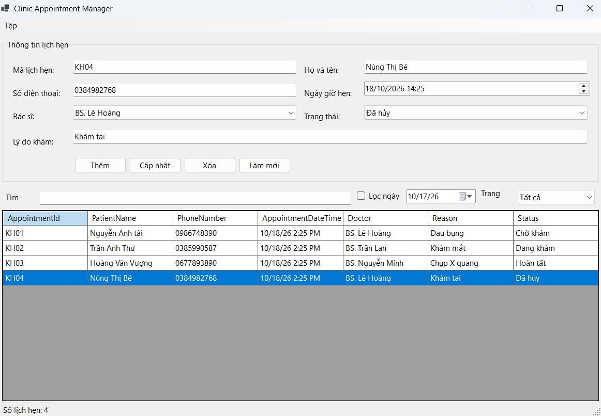
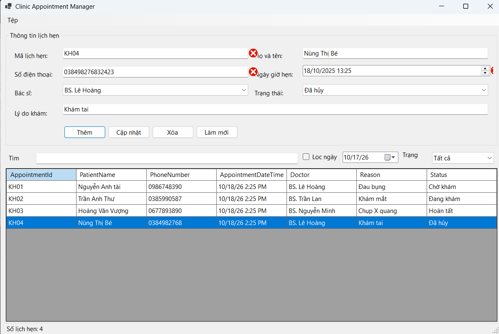
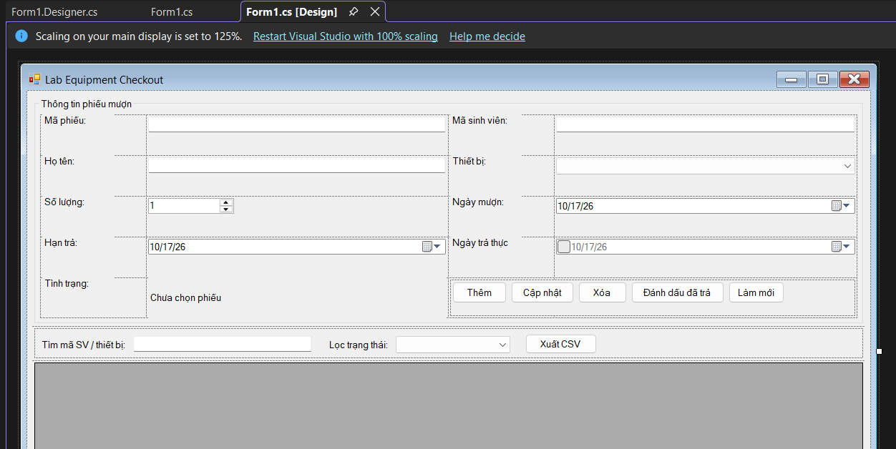
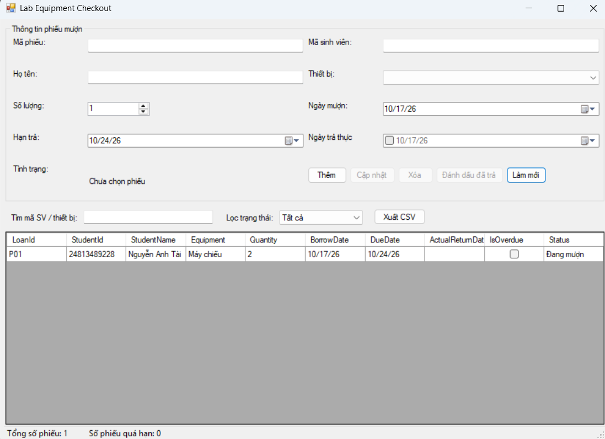
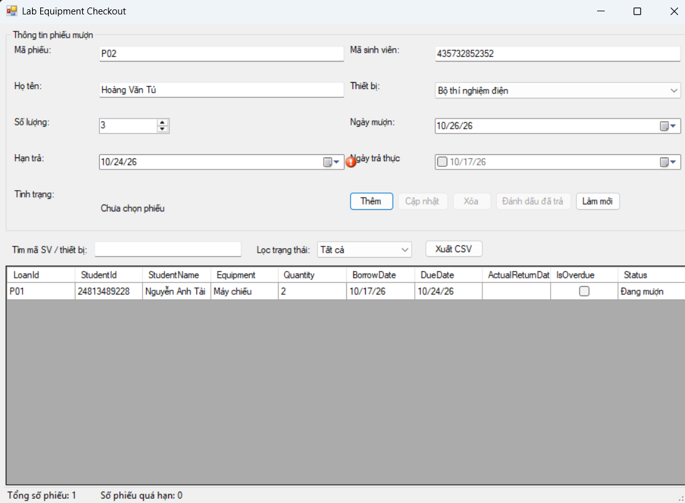
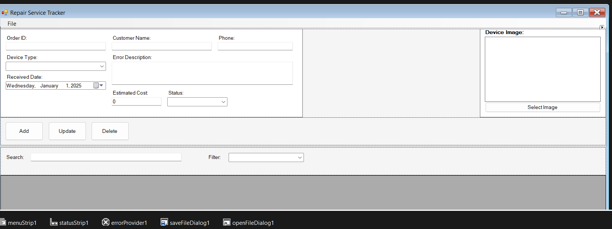
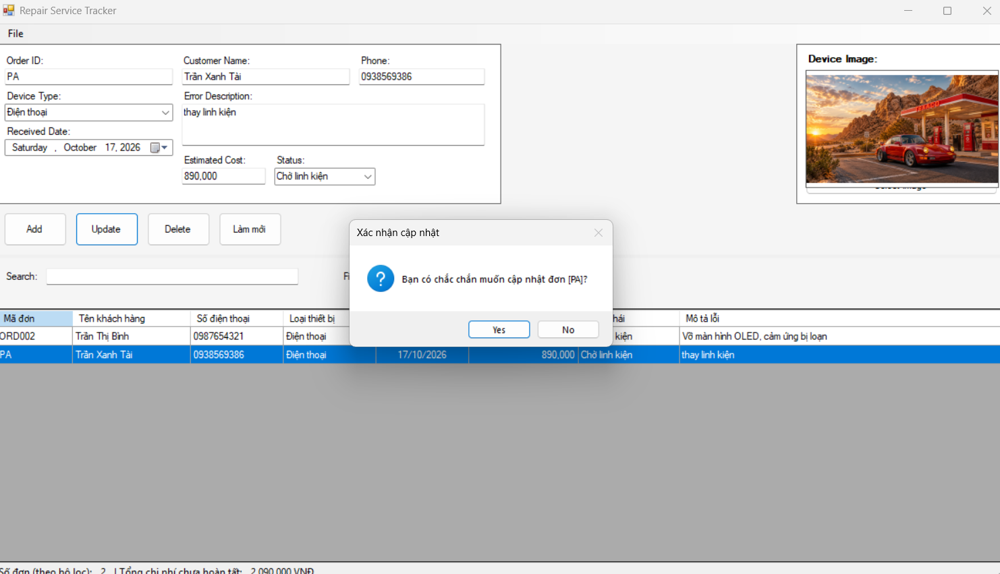
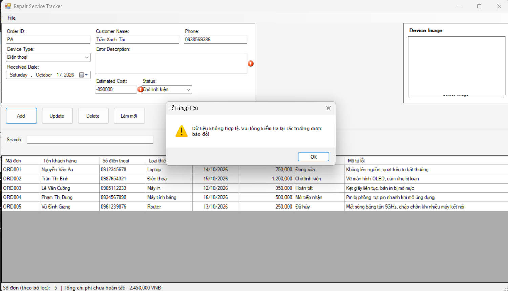

# BÁO CÁO BÀI TẬP THỰC HÀNH NGÀY 17/10/2026

## THÔNG TIN SINH VIÊN
- **Họ và tên:** Nguyễn Minh Trí
- **Mã số sinh viên:** 24810320227
- **Lớp:** D19QTANM1
- **Tên môn học:** Lập trình.net
- **Tên bài tập:** Bài thực hành 4.9 đến bài 4.11

----------------------------

## KẾT QUẢ THỰC HÀNH
## BAI TAP 4.9
### 1. Ảnh màn hình Giao diện chính

### 2. Ảnh màn hình kết quả

---------
.png)
---------
.png)
---------
.png)
---------
.png)
### 3. Ảnh màn hình Kiểm tra lỗi (Validation)

----------------------------

## KẾT QUẢ THỰC HÀNH
## BAI TAP 4.10
### 1. Ảnh màn hình Giao diện chính

### 2. Ảnh màn hình kết quả

---------
.png)
---------
.png)
---------
.png)
---------
.png)
---------
### 3. Ảnh màn hình Kiểm tra lỗi (Validation)

----------------------------

## KẾT QUẢ THỰC HÀNH
## BAI TAP 4.11
### 1. Ảnh màn hình Giao diện chính

### 2. Ảnh màn hình kết quả

---------
.png)
---------
.png)
---------
.png)
---------
.png)
---------
.png)
---------
### 3. Ảnh màn hình Kiểm tra lỗi (Validation)

